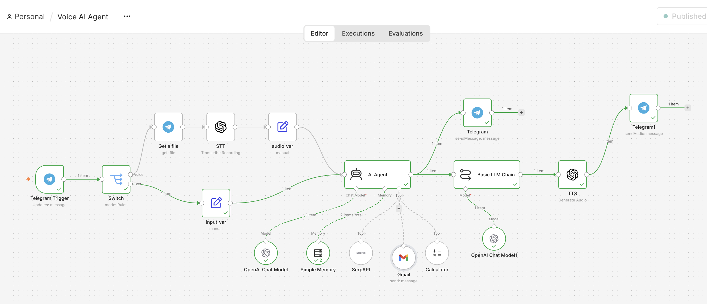
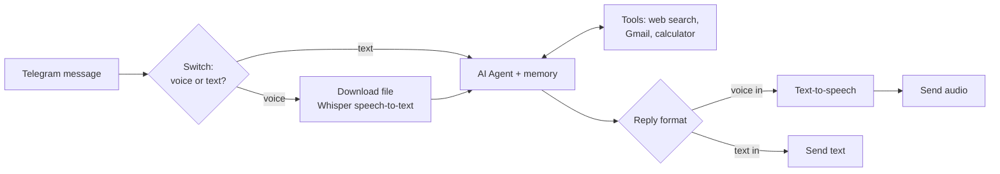
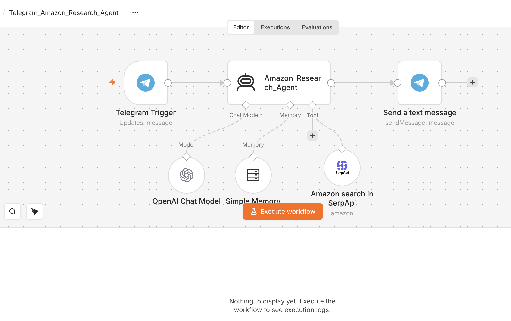

# AI Agents on Telegram (n8n)

Two production-style AI agents that live in Telegram, built with n8n's AI Agent node, OpenAI and tool calling.

## 1. Voice AI Assistant

Talk to it by **voice or text**. It transcribes voice notes, decides which tool to use, and replies in the same format you used (a voice message back for a voice message).

- **Tools:** SerpAPI web search, Gmail (send email), calculator
- **Memory:** remembers the conversation per chat
- [Chat screenshot](Voice_AI_Assistant/Voice_AI_chat.png)

## 2. Amazon Product Research Agent

Ask in plain language ("best noise-cancelling headphones under ₹10,000") and it searches Amazon through SerpAPI and returns a short comparison in Telegram.

## Setup

1. Create a Telegram bot with [@BotFather](https://t.me/BotFather) and copy the token.
2. In n8n: **Workflows → Import from File** and choose the JSON in each folder.
3. Add credentials for Telegram, OpenAI, SerpAPI (and Gmail for the voice assistant).
4. Activate the workflow and message your bot.

## Tech stack

n8n · OpenAI (GPT, Whisper, TTS) · Telegram Bot API · SerpAPI · Gmail API
